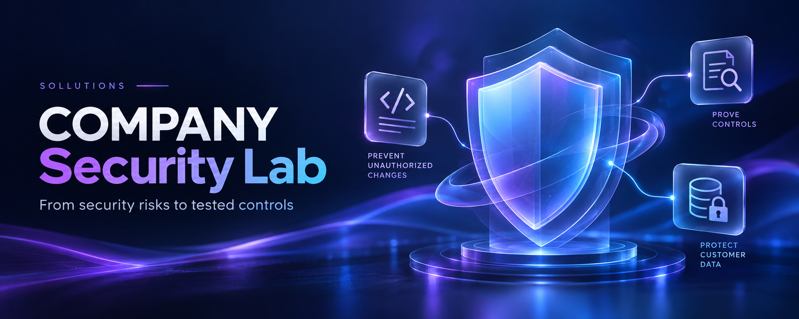
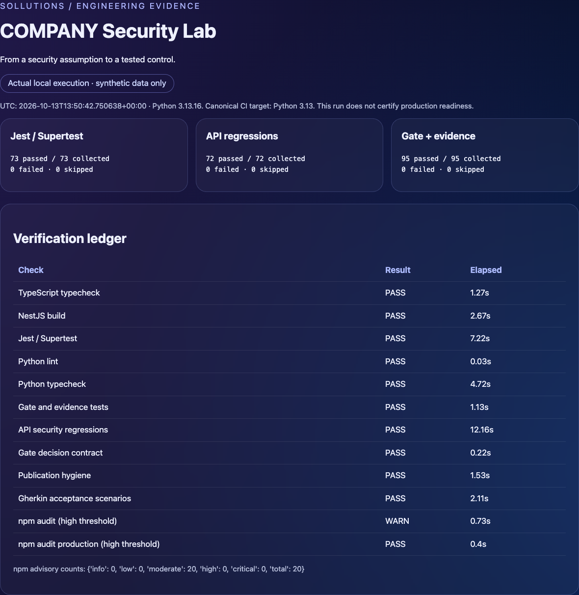
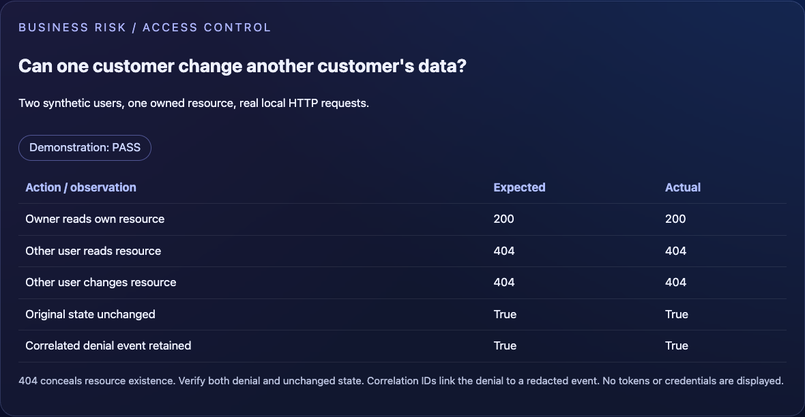
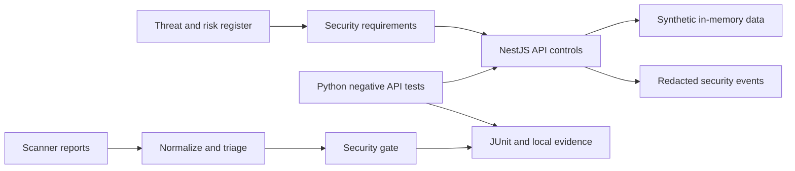

# COMPANY Security Lab · Sollutions

[](https://github.com/SollutionsIT/security_lab_2/actions/workflows/portfolio-native.yml)
[](https://github.com/SollutionsIT/security_lab_2/actions/workflows/pr-security.yml)
[](https://github.com/SollutionsIT/security_lab_2/actions/workflows/deep-security.yml)



**A hands-on DevSecOps / AppSec learning portfolio: identify a risk, implement a control, test the failure case, and retain evidence.**

COMPANY is a fictional business. This standalone lab uses synthetic identities, payments and files; it contains no customer environment or business application. Built as a QA-to-security learning project, it demonstrates skills relevant to junior / early-mid security engineering roles—not senior production ownership.

## The 60-second overview

| Business concern | What the lab demonstrates | Evidence |
|---|---|---|
| A customer sees or changes another customer's data | Ownership and role checks on every resource operation | Negative API tests; denied changes leave state unchanged |
| Untrusted files or integrations influence the application | Boundary validation, signed synthetic webhooks, replay/idempotency controls | NestJS and Python regression tests |
| A release proceeds without an explainable security decision | Scanner normalization, explicit PASS / WARN / FAIL / ERROR gates | Policy fixtures, tests, retained reports |
| Security work cannot be explained or repeated | Threat → requirement → code → test → evidence traceability | Risk registers, runbook, standards mapping |

This is a reference implementation to adapt in an authorized pilot—not an install-and-forget production security platform. See [business value](docs/business-value.md) and [adoption boundaries](docs/company-adoption.md).

## Real findings and tested threat scenarios

- **Detected and treated:** an actual dependency audit led to compatible NestJS/Multer updates and regression retests. High/critical entries disappeared in the recorded follow-up; moderate dev-tool findings remain visible.
- **Verified defenses:** cross-owner access/change, mass assignment, webhook replay and hostile input cases ran against the local API. A blocked synthetic request is not a discovered application vulnerability.
- **My reasoning:** priorities consider impact, exposure, evidence and residual risk—not severity labels alone. Current 2026 threat reports inform scenario selection, not an invented probability for this fictional company.

Start with [six evidence-backed case studies](docs/security-case-studies.md), [my prioritization rationale](docs/my-security-prioritization.md), [current threat sources](docs/threat-intelligence-2026.md) and [ATT&CK/CWE mappings](docs/attack-and-control-mapping.md).

## See it working

The screenshots below come from the [successful GitHub native run on 13 October 2026](https://github.com/SollutionsIT/security_lab_2/actions/runs/38408109348), not fabricated dashboards. “Local execution” in the report means loopback HTTP inside the GitHub runner, not a customer environment. It passed 73 Jest, 72 API, 95 gate/evidence tests and 14 Gherkin scenarios with no skips. Exact runtime, results and limitations are in [PROJECT_STATUS.md](PROJECT_STATUS.md). The banner above is a conceptual AI-generated illustration.





## How it fits together



An HTTP request passes through correlation metadata, request validation and guards. Domain services check resource ownership before touching state. Integration boundaries validate untrusted inputs. Python tests reset the lab, authenticate synthetic actors, exercise allowed and forbidden actions, then check both the response and side effects.

## Technologies—and why they are here

| Technology / approach | Purpose | Scope |
|---|---|---|
| TypeScript, NestJS, DTO validation, Helmet | Explicit request boundaries and application controls | Implemented |
| JWT validation, scrypt, reset-token digests | Authentication and lifecycle checks | Synthetic local identities |
| Python, pytest, HTTPX, Pydantic settings | Repeatable negative API tests and safe target configuration | Implemented; serial lab state |
| pytest-bdd / Gherkin | Business-readable ownership, protected-field, webhook and gate acceptance rules | 14 executable scenarios; complement the full matrix |
| Jest, Supertest, Ruff, mypy | Test application behavior and catch code/configuration mistakes | Local checks |
| Gitleaks + publication hygiene check | Detect secret patterns and prevent private material from entering a portfolio | Complementary checks; not proof of complete anonymization |
| Semgrep, npm audit, Trivy, OWASP ZAP | SAST, dependency, IaC/container and dynamic scanning | Independent jobs; consult the dated execution ledger |
| GitHub Actions, CodeQL, security gates | Automate verification and make release decisions explicit | Actual run links and limitations in the execution ledger |
| Docker, Kubernetes security contexts / policies | Least-privilege deployment examples | Templates; no production cluster claim |
| Syft / CycloneDX, hashes, provenance examples | Identify dependencies and trace delivery artifacts | Supply-chain examples; consult execution status |
| STRIDE, OWASP ASVS / API Security, NIST SSDF | Connect threat reasoning to concrete verification | Reference mapping, not formal certification |
| ISO/IEC 27001 management lens | Risk ownership, evidence, exceptions and review | No certification or complete compliance claim |

## Run locally

Prerequisites: Node.js 24.21.0, npm 11.19.0, Python 3.13, Git. Docker and external scanners are separate prerequisites for their respective commands.

```sh
make install
make ci-verify                     # starts and cleans up its own loopback API
open reports/portfolio/index.html   # macOS; use a browser on other systems
```

Only attack your own isolated lab. `make lab-native` intentionally enables a reset/test endpoint using synthetic credentials. Never enable test mode in a public or production deployment. Local HTTP is not a production TLS solution.

The [runbook](docs/local-runbook.md) explains scanner prerequisites, configuration, report interpretation, cleanup, GitHub Actions and GitLab CI. [Architecture](docs/01-architecture.md) explains modules and trust boundaries.

## CI/CD and executable acceptance scenarios

`make ci-verify` owns the native API lifecycle and runs core verification, the API matrix, Gherkin and full/production dependency gates. It requires a free loopback port 3001 and stops only its owned API process. Use `make bdd-test` for focused Gherkin checks with the native lab already running.

GitHub's `portfolio-native.yml` and the independent root `.gitlab-ci.yml` use the same command. Scanner jobs add secrets/SAST/Trivy checks; GitHub deep/release workflows cover additional configured integrations. GitLab displays JUnit and retains a verified build candidate on protected tags. Delivery means retained artifacts, not production deployment.

See [CI/Gherkin setup, gate policy and first-run checklist](docs/ci-cd-and-gherkin.md) and the dated [execution ledger](PROJECT_STATUS.md). Badges show workflow conclusions, not zero vulnerabilities: WARN findings still require triage. GitLab configuration is included but its remote execution is not claimed. [Career positioning and CV wording](docs/career-positioning.md) distinguish practical lab experience from commercial security ownership.

## Start reviewing here

- [Standards and engineering decisions](docs/standards-and-decisions.md): what informed the design and what it does **not** prove.
- [Threat model](docs/03-threat-model.md), [risk register](risk/risk-register.md), [requirements](docs/04-security-requirements.md): reasoning before tools.
- `lab-api/src/`: authentication, resource policy, integration boundaries and redacted events.
- `tests/security/`: owner isolation, authentication, inputs, side effects and logging checks.
- `security/scripts/`: normalization, policy decisions, publication checks and evidence tooling.
- `.github/workflows/`, `kubernetes/`: automation and deployment examples.
- [Publication checklist](docs/publication.md): review only the sanitized standalone directory.

## Honest limitations and learning ownership

No live cloud, Kubernetes, payment, LLM or customer environment is claimed. Persistence is in-memory. Shared test state means the API suite must run serially. SSRF checks demonstrate policy decisions, not a production egress proxy. AI behavior is mocked. ZAP baseline covers the unauthenticated health endpoint, not the complete API. Scanner output requires triage; a green test suite does not prove an application has no vulnerabilities. Local, GitHub-runner and production evidence are different scopes.

AI assistance was used for implementation and documentation. The learning work is understanding the design, validating behavior, examining failures and explaining tradeoffs—not claiming every line was independently authored. Proposed future integrations (DefectDojo, Wazuh, Vault, Checkov) are described as future work, not acquired production experience.

## License

**Source-available, non-commercial—not OSI open source.** Learning, review, recruitment evaluation and non-commercial modification are allowed under [LICENSE](LICENSE). Commercial deployment, internal commercial operations, resale and paid services require separate permission. Third-party dependencies retain their own licenses. This lab provides no security or compliance warranty.

Brand: **Sollutions**. No personal identity or customer affiliation is represented.
