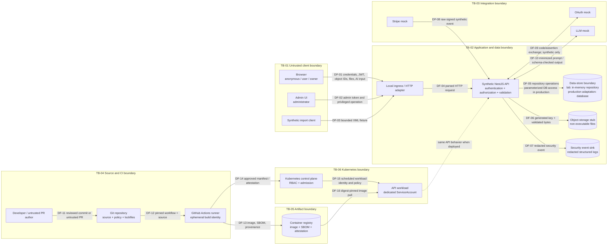

# Threat model and data-flow diagram

## What is it?

This document turns the synthetic lab architecture into explicit data flows, trust boundaries, abuse scenarios, and testable security decisions. It is a design artifact for the public portfolio; it is not a penetration-test report and it does not describe a production deployment.

The model is deliberately traceable:

`Threat -> Requirement -> Control -> Verification -> Evidence -> Residual risk`

The canonical scenario details are maintained in the [threat register](../risk/threat-register.md), requirements in [04-security-requirements.md](04-security-requirements.md), and prioritization in the [risk register](../risk/risk-register.md).

## Evidence state

| Statement | State | Meaning |
|---|---|---|
| The lab models REST/JWT, owned resources, webhook/upload/XML/AI boundaries and delivery controls | **CONFIRMED FROM SOURCE** | Source structure only; no production effectiveness inferred |
| Infrastructure and integration components without execution evidence | **TARGET DESIGN** | Examples requiring validation; consult PROJECT_STATUS.md |
| Every scenario `T-*` below | **MODELED THREAT** | A plausible failure or attack path, not a finding |
| Controls and `VER-*` checks described below | **REQUIRES RUNTIME VALIDATION** | Planned until implementation and a retained test/scanner artifact exist |

These scenarios are modeled threats, not discovered customer vulnerabilities. Current runtime evidence is maintained in PROJECT_STATUS.md.

## Threat

The system accepts untrusted identities, identifiers, files, XML, webhook messages, and AI input. It also lets automation turn source into a deployable artifact. The primary threat is that trust is granted because data crossed a technical layer rather than because identity, authorization, integrity, provenance, and resource limits were independently verified at the boundary where they matter.

## Why it matters

Authentication does not prove authorization, a signed webhook does not prove that an event is fresh or safe to apply, a valid MIME type does not prove safe content, and a passing scanner does not prove the absence of vulnerabilities. The model keeps those distinctions visible and gives each important assumption a planned negative test or review method.

## Scope and assumptions

In scope:

- the local NestJS API and deterministic in-memory repository;
- synthetic `User`, `Property`, `Invoice`, `Attachment`, and `WebhookEvent` data;
- anonymous, ordinary user, resource owner, and administrator behavior;
- local OAuth, Stripe, object-storage, XML, and LLM stubs;
- source, GitHub Actions, container artifacts, registry interactions, and hardened Kubernetes examples;
- confidentiality, integrity, availability, accountability, tenant isolation, and software provenance.

Out of scope:

- all customer applications and production environments;
- real customer data, credentials, cloud accounts, payment providers, OAuth providers, object storage, SMTP, feeds, or LLMs;
- external targets, metadata services, private-network services, and real malware;
- claims about a managed Kubernetes control plane or registry that is not instantiated by this lab.

Assumptions:

- dynamic checks target only loopback or the isolated lab container network;
- the `owner` attribute is a server-side relationship to an object, not a trusted client role or JWT claim;
- an identifier is attacker-controlled even when it is syntactically valid;
- external-service mocks are separate trust zones because their responses remain untrusted;
- pull-request content is untrusted; protected release credentials are unavailable to untrusted PR jobs;
- local HTTP can be used on loopback for the lab; TLS is a production requirement;
- Kubernetes and registry flows are design examples until an explicitly isolated test environment supplies evidence.

## Assets and security objectives

| Asset ID | Asset | Primary objective |
|---|---|---|
| `A-IDENTITY` | Passwords, reset tokens, JWT claims, synthetic OAuth assertions | Confidentiality, authenticity, freshness |
| `A-AUTHZ` | Roles, ownership relations, tenant and field permissions | Integrity, least privilege |
| `A-DOMAIN` | Properties and invoices | Confidentiality and integrity |
| `A-PAYMENT` | Synthetic webhook events and invoice/payment state | Authenticity, integrity, idempotency |
| `A-FILES` | Attachments, filenames, metadata, parsed content | Confidentiality, integrity, availability |
| `A-AI` | Prompt inputs, model outputs, tool policy, quotas | Data minimization, integrity, containment |
| `A-SECRETS` | Local signing and webhook test secrets; CI credentials in the delivery model | Confidentiality, rotation, least privilege |
| `A-LOGS` | Security events, correlation IDs, audit records | Integrity, minimization, availability |
| `A-SOURCE` | Source, workflow definitions, lockfiles, policies | Integrity, reviewability |
| `A-ARTIFACT` | Container image, SBOM, provenance, attestations | Integrity, authenticity, traceability |
| `A-CLUSTER` | Service accounts, RBAC, workloads, admission and network policy | Least privilege, isolation, availability |
| `A-AVAILABILITY` | CPU, memory, request capacity, storage and third-party quotas | Availability, cost containment |

## Data-flow diagram

Trust boundaries are drawn as Mermaid subgraphs. Every arrow crossing a subgraph edge is a trust-boundary crossing and must validate the sender, data, and allowed operation independently.

The dotted workload-to-API edge is logical, not a second runtime instance. It shows that application controls remain necessary after infrastructure controls are added.

## Trust boundaries

| Boundary | What changes | Required decision at the boundary | Planned evidence |
|---|---|---|---|
| `TB-01` client to API | All fields, identifiers, tokens, MIME declarations, and roles become untrusted input | Authenticate where required; authorize every object/function; validate type, shape, content type, size, and rate | API unit tests plus Python negative tests |
| `TB-02` API to data/storage/logs | Application logic becomes persistence and durable evidence | Use server-derived ownership, allowlisted writes, parameterized operations, generated filenames, safe download headers, redaction | State-before/state-after assertions and captured log tests |
| `TB-03` API to integration mocks | A nominally trusted provider sends or receives untrusted data | Verify signatures/assertions, freshness, issuer/audience, allowlisted destinations/tools, schemas, timeouts, and quotas | Webhook, OAuth-policy, SSRF-policy, XML, and AI-boundary tests |
| `TB-04` source to CI runner | Contributor-controlled text may execute in a credentialed environment | Pin actions, minimize permissions, isolate PRs, avoid unsafe interpolation, enforce lockfiles and timeouts | actionlint/review plus workflow-policy checks |
| `TB-05` CI to registry | Build output becomes a distributable artifact | Bind image digest to SBOM/provenance; scan; attest; grant narrowly scoped publish rights | SBOM, scan report, attestation and digest checks |
| `TB-06` delivery to cluster | Artifact and manifest gain runtime identity and network reach | Admission policy, non-root runtime, restricted RBAC, no automatic token, NetworkPolicy, resource limits, controlled ingress | IaC scan and policy tests; runtime remains separately validated |

## Data-flow security decisions

| Flow | Security decision |
|---|---|
| `DF-01`–`DF-04` | The API rejects unexpected properties, oversized bodies, unsupported content types, invalid JWTs, and unauthorized object or function access. A valid JWT alone never grants object access. |
| `DF-05` | The trusted service layer resolves ownership and allowed fields; clients cannot set `ownerId`, `role`, or `isVerified`. |
| `DF-06` | The server verifies extension, MIME and magic bytes, generates the storage key, writes outside an executable/static path, and returns safe download headers. |
| `DF-07` | Logs contain necessary actor/action/result/correlation metadata and exclude passwords, bearer tokens, reset tokens, OAuth codes, webhook secrets, unnecessary PII, and full sensitive payloads. |
| `DF-08` | Signature covers the exact raw bytes; timestamp tolerance, replay detection, durable event ID, idempotency, event ordering, and server-side amount/resource binding are separate checks. |
| `DF-09` | The mock models issuer, audience, state/nonce and signature decisions; real provider configuration remains a production validation task. |
| `DF-10` | Both prompt input and model output are untrusted. Tools and URLs are allowlisted; input/output are bounded and schema validated; no secret enters the prompt. |
| `DF-11`–`DF-12` | A PR cannot gain release credentials or turn PR-controlled text into a shell command. Workflow actions and tool versions are immutable or explicitly pinned. |
| `DF-13`–`DF-16` | The release decision binds reviewed source to a digest, SBOM, scan evidence, provenance, approved manifest, and the exact pulled image. |

## STRIDE scenario inventory

The first table defines the abuse/failure scenario; the second attaches the required control, detection, verification, and residual risk using the same ID.

| Threat ID | STRIDE | Asset | Threat actor | Entry point / boundary | Attack or failure scenario |
|---|---|---|---|---|---|
| `T-AUTH-001` | Spoofing, DoS | `A-IDENTITY`, `A-AVAILABILITY` | Anonymous credential attacker | `/auth/login`, `TB-01` | Credential stuffing or response differences identify an account and obtain a session or exhaust the login path. |
| `T-RESET-001` | Spoofing, Elevation | `A-IDENTITY` | Anonymous attacker or token thief | Password-reset endpoints, `TB-01`/`TB-02` | A predictable, reusable, long-lived, disclosed, or enumerable reset token enables account takeover. |
| `T-OAUTH-001` | Spoofing, Tampering | `A-IDENTITY` | Malicious client or compromised identity response | OAuth callback/mock, `TB-03` | An assertion with the wrong issuer, audience, signature, state, nonce, or identity namespace is accepted. |
| `T-AUTHZ-001` | Elevation, Information disclosure, Tampering | `A-AUTHZ`, `A-DOMAIN` | Authenticated user B | Property/invoice IDs, `TB-01`/`TB-02` | User B reads, changes, or deletes user A's object by changing an identifier; denial may still leak fields or mutate state. |
| `T-AUTHZ-002` | Elevation | `A-AUTHZ`, `A-DOMAIN` | Ordinary user | Admin operation, `TB-01` | A user invokes an administrator-only function because only authentication, UI hiding, or a client role is checked. |
| `T-INPUT-001` | Tampering, Elevation | `A-AUTHZ`, `A-DOMAIN` | Authenticated user | JSON DTO, `TB-01` | Mass assignment of `role`, `ownerId`, or `isVerified`, weak typing, or nested unexpected fields changes protected state. |
| `T-WEBHOOK-001` | Spoofing, Tampering, Repudiation | `A-PAYMENT` | Anonymous sender or replay actor | `/webhooks/stripe`, `TB-03` | A missing/invalid/old signature, body modified after signing, duplicate or out-of-order event changes invoice state twice or binds the wrong amount/resource. |
| `T-UPLOAD-001` | Tampering, Elevation, DoS | `A-FILES`, `A-AVAILABILITY` | Authenticated uploader | `/uploads`, `TB-01`/`TB-02` | A MIME/extension mismatch, traversal filename, empty/oversized/unsupported content, or parser-heavy file is trusted, executed, misplaced, or exhausts resources. |
| `T-XML-001` | Information disclosure, Elevation, DoS | `A-FILES`, `A-DOMAIN`, `A-AVAILABILITY` | Import submitter | `/imports/xml`, `TB-01`/`TB-03` | DTD, external entity, deep nesting, or entity expansion causes file/network access, unsafe data injection, or resource exhaustion. |
| `T-SSRF-001` | Information disclosure, Elevation | `A-SECRETS`, `A-CLUSTER` | User controlling a URL or integration response | URL policy, `TB-03` | Alternate schemes, redirects, DNS/IP tricks, loopback, link-local, private, or metadata destinations bypass the intended outbound allowlist. |
| `T-AI-001` | Tampering, Information disclosure, Elevation, DoS | `A-AI`, `A-SECRETS`, `A-DOMAIN`, `A-AVAILABILITY` | Prompt author or malicious model output | `/ai/parse`, `TB-01`/`TB-03` | Prompt injection or unvalidated output triggers an unapproved tool/URL, leaks excessive data, changes state, or consumes unbounded resources. |
| `T-RESOURCE-001` | DoS | `A-AVAILABILITY` | Anonymous or authenticated abusive client | Login, reset, public form, AI, upload/XML | Small repeated or individually expensive requests exhaust CPU, memory, storage, queues, or cost quotas. |
| `T-LOG-001` | Repudiation, Information disclosure, Tampering | `A-LOGS`, `A-SECRETS` | Attacker influencing log fields or privileged reader | Security event path, `TB-02` | Missing/corrupted events prevent investigation, while passwords, JWTs, headers, reset tokens, codes, secrets, payloads, or PII leak through logs. |
| `T-SECRET-001` | Information disclosure, Elevation | `A-SECRETS`, `A-SOURCE` | Repository reader or compromised build step | Configuration and repository, `TB-04` | A real/default credential is committed, printed, embedded in an artifact, or a placeholder is accepted in a production profile. |
| `T-CI-001` | Tampering, Elevation, Repudiation | `A-SOURCE`, `A-SECRETS`, `A-ARTIFACT` | Untrusted PR author or compromised action | Workflow/event/shell input, `TB-04` | PR-controlled data executes with broad token/secrets, an action changes under a floating tag, or evidence is overwritten without attribution. |
| `T-SUPPLY-001` | Tampering, Elevation | `A-SOURCE`, `A-ARTIFACT` | Compromised or confusing package source | Package/action/image resolution, `TB-04`/`TB-05` | Unlocked, unpinned, vulnerable, abandoned, or dependency-confused components enter the build; a scan result is mistaken for exploitability proof. |
| `T-REGISTRY-001` | Spoofing, Tampering, Repudiation | `A-ARTIFACT` | Registry attacker or misconfigured publisher | Push/pull, `TB-05`/`TB-06` | An image is substituted, mutable tag moves, or an unsigned/unattested artifact is deployed without a binding to source and SBOM. |
| `T-K8S-001` | Elevation, Tampering | `A-CLUSTER`, `A-SECRETS` | Compromised workload | ServiceAccount/RBAC/runtime, `TB-06` | Root execution, added capabilities, privilege escalation, writable root filesystem, mounted token, or wildcard RBAC enables cluster pivoting. |
| `T-K8S-002` | Information disclosure, Elevation, DoS | `A-CLUSTER`, `A-DOMAIN`, `A-AVAILABILITY` | Network attacker or compromised peer workload | Ingress, dashboard/control plane, pod network, `TB-06` | Public administration exposure, unrestricted east-west traffic, missing resource limits, or broad namespace access expands blast radius. |

| Threat ID | Required control | Detection | Verification | Residual risk after the intended control |
|---|---|---|---|---|
| `T-AUTH-001` | Generic errors, typed DTO, password policy, per-identity and per-source throttling | Correlated login failures and rate-limit events | `VER-AUTH-001`, `VER-RATE-001` | Distributed low-and-slow attacks and compromised valid credentials remain possible. |
| `T-RESET-001` | CSPRNG opaque token, hashed storage, expiry, single use, generic response, throttling, no token logging | Reset requests, invalid/expired/reused-token events without token value | `VER-RESET-001`, `VER-LOG-002` | Email-channel compromise and user-device compromise are outside the lab. |
| `T-OAUTH-001` | Signature, issuer, audience, state/nonce and subject-namespace validation | Assertion validation failures by reason code | `VER-OAUTH-001` | A mock cannot prove a real provider or redirect-URI configuration. |
| `T-AUTHZ-001` | Deny by default; server-side actor/object/action/state policy on every operation; minimal response | `authorization_denied` event with correlation ID | `VER-AUTHZ-001` plus pre/post state assertion | Policy defects and race conditions require review and broader production testing. |
| `T-AUTHZ-002` | Trusted-service role/permission guard independent of UI and token presence | Denied admin-operation event | `VER-AUTHZ-002` | Abuse by a legitimately privileged administrator needs governance and monitoring. |
| `T-INPUT-001` | Typed DTOs; whitelist plus forbidden unknown fields; operation-specific writable-field allowlist | Validation-bypass and protected-field attempts | `VER-INPUT-001`, `VER-MASS-001` | Semantically valid but harmful combinations require business-rule tests. |
| `T-WEBHOOK-001` | Raw-body signature, bounded timestamp, constant-time comparison, unique event ID, atomic idempotency, server-side binding | Signature, age, replay, duplicate and state-transition events | `VER-WEBHOOK-001` | Provider key compromise and legitimate-but-incorrect upstream events remain production concerns. |
| `T-UPLOAD-001` | Size/MIME/extension/magic validation, generated name, non-executable storage, quota, safe response headers | Rejection reason, quota event, storage write audit without raw content | `VER-UPLOAD-001` | Well-formed malicious content and parser zero-days need production scanning/sandboxing. |
| `T-XML-001` | Reject DTD/entities; no resolver/network; limit bytes/depth/nodes/time | Safe parser rejection and resource-limit event | `VER-XML-001` | Parser implementation defects remain; the lab never performs live SSRF. |
| `T-SSRF-001` | Canonical parsing, scheme/host/port allowlist, DNS/IP policy, no redirects, time/byte limits | Denied destination category and redirect event, without sensitive URL data | `VER-SSRF-001` | Allowlisted-host compromise and DNS rebinding need layered egress controls in production. |
| `T-AI-001` | Data minimization, bounded input/output, schema validation, tool/URL allowlist, quotas, mocked model | Tool denial, schema failure, quota and redaction events | `VER-AI-001`, `VER-LOG-002` | Semantic prompt injection cannot be fully eliminated; consequential actions need human or deterministic authorization. |
| `T-RESOURCE-001` | Request/body/file/depth limits, rate limits, timeouts, quotas and concurrency bounds | Limit and saturation metrics/events | `VER-RATE-001`, `VER-UPLOAD-001`, `VER-XML-001`, `VER-AI-001` | Distributed load and infrastructure-layer exhaustion require production capacity controls. |
| `T-LOG-001` | Structured schema, encoding, correlation, redaction, access control, append/forward design | Missing-event tests, redaction tests, log-pipeline health | `VER-LOG-001`, `VER-LOG-002` | Novel event types may be uninstrumented; external sink integrity is not implemented locally. |
| `T-SECRET-001` | Environment schema, production placeholder rejection, secret scanning and artifact inspection | Gitleaks plus startup configuration failure | `VER-SECRET-001` | Secrets introduced outside version control require a real secret manager and rotation process. |
| `T-CI-001` | Minimal permissions, immutable action refs, no `pull_request_target`, no PR-to-shell interpolation, job isolation/timeouts | Workflow-policy checks, audit log, actionlint | `VER-CI-001` | Hosted-runner and trusted-maintainer compromise cannot be eliminated by workflow syntax alone. |
| `T-SUPPLY-001` | Lockfiles, trusted registries, dependency review/SCA, update SLA, SBOM | SCA/Trivy results normalized with reachability and fix context | `VER-SUPPLY-001` | Unknown vulnerabilities and malicious-but-not-yet-detected packages remain. |
| `T-REGISTRY-001` | Digest references, least-privilege publish, provenance and attestation verification | Digest/provenance mismatch and unauthorized-push audit | `VER-ARTIFACT-001` | Signing-identity or registry control-plane compromise needs independent operational controls. |
| `T-K8S-001` | Non-root, no privilege escalation, read-only root, drop capabilities, RuntimeDefault seccomp, dedicated/no-token SA, narrow RBAC | IaC misconfiguration scan and admission/runtime audit | `VER-K8S-001` | Kernel/container-runtime vulnerabilities and managed control-plane configuration remain out of scope. |
| `T-K8S-002` | Namespace separation, default-deny NetworkPolicy, controlled ingress, no public dashboard pattern, resource limits | IaC scan, network-policy tests, cluster audit in an authorized environment | `VER-K8S-002` | CNI enforcement differences and real ingress/cloud configuration require deployment-specific validation. |

## Abuse-case invariants

These are the invariants the later implementation and tests must preserve:

1. **Authentication is not authorization.** A valid JWT identifies a subject but never proves object ownership or admin permission.
2. **Deny tests inspect side effects.** A `403` or `404` is insufficient unless protected fields are absent, state is unchanged, and the appropriate security event is emitted.
3. **Signatures do not provide idempotency.** A correctly signed event can still be old, duplicated, out of order, or bound to the wrong server-side invoice.
4. **Declared file type is not content proof.** Client MIME, extension, magic bytes, quotas, storage location, and response headers are distinct controls.
5. **Parsing is a trust transition.** XML and model output stay untrusted after they are syntactically parsed.
6. **CI is privileged code execution.** Pull-request data, workflow dependencies, credentials, artifacts, and evidence each need their own boundary decision.
7. **A signed artifact is not automatically safe.** Provenance proves origin/process claims; scans and review address different questions.
8. **Kubernetes hardening limits blast radius.** It does not repair application authorization or prove the security of a real cluster.

## Where it belongs in the SDLC

| SDLC point | Threat-model activity |
|---|---|
| Requirements | Define assets, abuse cases, data classifications, invariants, and acceptable residual risk. |
| Design | Draw boundaries/flows; enumerate STRIDE scenarios; select requirement and owner. |
| Implementation | Preserve security decisions in DTOs, services, policies, stubs, workflows and manifests. |
| Pull request | Review changed flows and run relevant unit, policy, secret, SAST, SCA and IaC checks. |
| Build/test | Produce container/SBOM; run isolated API security tests and local-only DAST. |
| Release | Evaluate normalized evidence, exceptions, provenance and artifact identity. |
| Deploy/operate | Enforce least privilege, collect security telemetry, investigate drift and reassess assumptions. |

## Implementation

Phases 4–20 implement the local controls and delivery configuration. Each `T-*` entry has one or more `SEC-*` requirements and `VER-*` checks in [04-security-requirements.md](04-security-requirements.md). A control is verified only when its specified evidence succeeds; `PROJECT_STATUS.md` separates executed native evidence from configured external tooling.

## How to verify locally

Run `make unit` and, with the local lab started, `make security-test`. Exact current results and unavailable external tools are recorded in `PROJECT_STATUS.md`.

Verification must:

- use only the local synthetic lab;
- use deterministic benign regression fixtures, never live external callbacks or malware;
- assert response, protected-data disclosure, persisted side effect, and audit event where relevant;
- identify evidence by requirement and test ID;
- record a tool execution error separately from a successful scan that reports a finding.

## CI/CD integration

Threat-model changes are review inputs. Later pipelines should require relevant owners when a PR adds an endpoint, actor, data class, external integration, workflow permission, registry path, or Kubernetes privilege. Automated checks verify specific controls; they do not automatically assert that the threat model is complete.

## Security gate

At Phase 2 the gate is **not implemented**. Later policy should fail on validated blocking risk, warn on uncertain or medium-priority evidence, and return `ERROR` when a scanner or evidence parser fails. A modeled threat by itself is not a failing finding.

## False positives / limitations

- STRIDE is a prompt for structured reasoning, not proof of exploitability or completeness.
- The DFD represents the target architecture; actual code and deployment can drift.
- The source analysis was static; it supports architectural relevance, not vulnerability claims.
- Local mocks cannot prove real provider, registry, runner, cloud, CNI, admission, or control-plane configuration.
- Automated tests can prove known invariants for covered cases; they cannot prove absence of authorization, parser, AI, or supply-chain flaws.

## Real-world usage

For a production adaptation, replace assumptions with named systems and owners, classify real data, enumerate every identity and egress destination, add deployment-specific diagrams, validate provider configuration, record compensating controls, and obtain risk acceptance with an expiry. Repeat the review whenever a flow, privilege, trust boundary, or critical dependency changes.

## Interview answer

> I start with assets and data flows, then mark every place where identity, data, or execution authority crosses a trust boundary. I use STRIDE to generate concrete scenarios, but I do not call them vulnerabilities. Each scenario gets a requirement, a control owner, a negative verification, expected evidence, and explicit residual risk. In this project that means, for example, a BOLA threat is tied to server-side ownership checks and a test that verifies both the response and unchanged state, while the CI threat is tied to least permissions, pinned actions, and provenance checks.

## Reference baseline

- [OWASP ASVS 5.0.0](https://github.com/OWASP/ASVS/tree/v5.0.0) for verifiable application requirements.
- [OWASP Top 10:2025](https://owasp.org/Top10/2025/) as an awareness and review crosswalk, not a complete verification standard.
- [OWASP API Security Top 10:2023](https://owasp.org/API-Security/editions/2023/en/0x10-api-security-risks/) for API-specific risk themes.
- [OWASP WSTG v4.2](https://owasp.org/www-project-web-security-testing-guide/v42/) for versioned test-method references.
- [MITRE CWE](https://cwe.mitre.org/) for weakness taxonomy; CWE mappings describe possible weakness classes, not confirmed defects.
