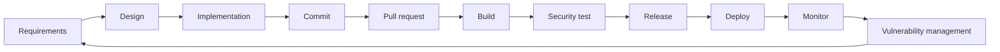

# Secure SDLC mapping

| Stage | Security control | Evidence / decision |
|---|---|---|
| Requirements | abuse cases, authn/authz/privacy acceptance criteria | requirement IDs mapped to threats/tests |
| Design | DFD, data classification, STRIDE, trust boundaries | reviewed threat/risk registers |
| Implementation | strict DTOs, centralized policy, secure integrations, redacted events | code and unit tests |
| Commit | local lint, secret scan, scanner-rule self-tests | pre-commit result |
| Pull request | Gitleaks, Semgrep, dependency review, SCA/IaC, unit | independent fast checks |
| Build | `npm ci`, pinned image, non-root runtime | reproducible container candidate |
| Security test | CodeQL, API regression, Trivy, local ZAP | reports normalized to gate input |
| Release | risk gate, SBOM, checksum, provenance | retained artifact evidence |
| Deploy | digest pin, external secrets, admission/RBAC/network policy | **requires platform validation** |
| Monitor | structured events, redaction, detections and runbooks | **requires collector/SIEM validation** |
| Vulnerability management | validate, prioritize, remediate, retest, exceptions | finding record and closure evidence |

Fast checks protect feedback time; deeper artifact/runtime checks protect main/nightly/release. A scanner result is never silently converted into a confirmed vulnerability, and a broken scanner is never a pass.
