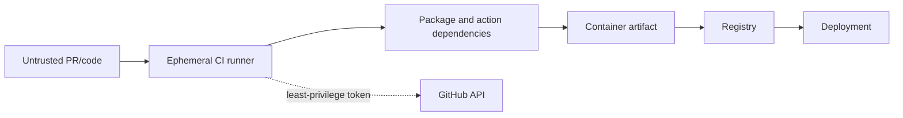

# Supply-chain security, SBOM and provenance

Threats include dependency substitution, mutable Actions, CI credential theft, artifact replacement and deploying a different digest than the one scanned. Controls are exact dependency pins and lockfiles, immutable Action SHAs, minimal workflow permissions, digest-pinned bases, Trivy, CycloneDX SBOM, provenance and digest deployment.

An SBOM answers “what components are in this artifact?” A scanner correlates components with advisories and policy context. Neither proves exploitability. `generate_sbom.sh` uses Syft; CI retains its CycloneDX JSON.

The release workflow builds once, records the digest, scans it, emits the SBOM and creates build provenance. Publication remains disabled until a real registry is configured. Cosign keyless signing is a production recommendation, not a claimed local implementation.

## Interview answer

I bind evidence to the artifact digest: reproducible inputs produce an image, that exact image is scanned, its SBOM is retained, and provenance states which workflow built it. SBOM, scanning and attestation answer different questions, so I use them together.
