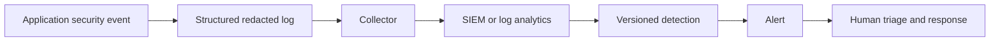

# Security observability and detection

The working lab retains bounded structured events for test assertions and redacts secret-shaped keys recursively. The YAML examples under `security/detections/` are vendor-neutral production recommendations for login failures, authorization probing, webhook verification failures and suspicious admin activity.

Runtime validation must establish schema delivery, clock synchronization, retention, alert routing, baselines and source-IP handling. Alerts are hypotheses: a burst can be abuse, a broken client or clock drift. Never include passwords, bearer tokens, reset tokens, webhook secrets, OAuth codes, prompts or full sensitive payloads.

## Interview answer

I design detection with the control: emit a stable redacted event and correlation ID, transport it centrally, aggregate behavior over time, and give responders enough context to validate without exposing secrets. I test event production locally; SIEM delivery, thresholds and runbooks require environment-specific validation.
